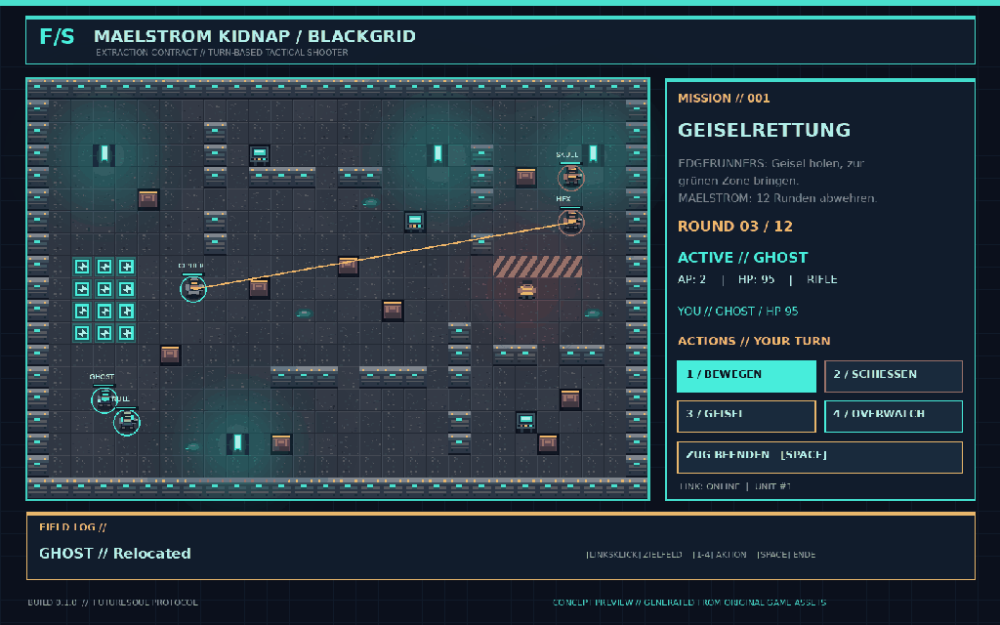

# FUTURE / SOUL

**Cyberpunk-Taktikshooter · Godot 4.4.1 · Top-down · rundenbasiert · LAN-PvP**

> **Status: spielbarer Entwicklungsprototyp v0.2.0.** Die drei grundlegenden Modi, Fraktions-/Charakterauswahl, Spezialfähigkeiten und das Code-Matrix-Minispiel sind implementiert. Keine finale Veröffentlichung oder ausbalancierte Vollversion. Spieltests auf zwei echten Windows-PCs stehen noch aus.



*Dies ist ein Design-Mockup mit originalen FutureSoul-Sprites, kein echter In-Game-Screenshot. Die eingebauten Pixelart-Assets liegen unter `assets/`; der Sprite-Generator ist `tools/build_art.py`.*

## Starten

1. [Godot 4.4.1](https://godotengine.org/download/archive/4.4.1-stable/) herunterladen.
2. Repository als ZIP herunterladen, entpacken, `project.godot` mit Godot öffnen.
3. **F5**: Spiel starten. Wähle rechts Fraktion, Spezialklasse, Rüstungsfarbe und Waffen-Loadout.
4. Links Modus wählen und **Solo-Training** für den lokalen Test oder **Host erstellen** für LAN-PvP auswählen.
5. Zweiter PC: **Join** und die LAN-IPv4-Adresse des Hosts eingeben, Port **UDP 7777**. Kein dedizierter Server, Matchmaking oder NAT-Traversal.

## Spielmodi

| Modus | Ziel |
| --- | --- |
| **01 / Maelstrom Kidnap** | Blaue Seite (Edgerunner oder Kobantec) befreit die Geisel in der Maelstrom-Basis und bringt sie zur grünen Extraktionszone. Rot hält die 12-Runden-Frist oder eliminiert die Angreifer. |
| **02 / Base vs Base** | Zwei Teams verteidigen je einen Stützpunkt und schalten das feindliche Team aus. Rundengrenze: der höhere verbliebene Team-HP-Wert entscheidet, Gleichstand möglich. |
| **03 / Hack the Base** | Im gegnerischen Stützpunkt an den Terminals **01** und **02** nacheinander Zugangscodes extrahieren, danach den gegnerischen **CORE** hacken. Jede Codeextraktion erfordert die spielbare vierteilige Code-Matrix. |

**Hack-Regeln:** Starte in der oberen Zeile; wähle danach abwechselnd in derselben Spalte und derselben Zeile. Der Host prüft alle vier gewählten Koordinaten und die AP-Kosten. Netrunner (Edgerunner) und Raven zahlen nur 1 AP je erfolgreichem Hack.

## Fraktionen & Klassen

| Fraktion | Klasse | Besonderheit |
| --- | --- | --- |
| **Maelstrom** | Gunner | Schweres MG; Unterdrückung und Waffenblockade |
| | Punk Schläger | Smartpistole/Mantisklingen; Flächen-Nahkampf |
| | Shooty | Punk-Schrotflinte; Doppelschuss |
| **Edgerunner** | The Big | Extrem starke Handkanone; Powerschuss |
| | The Snipeout | Sniper; eine Wand durchdringen, Scharfschützen-Skill |
| | Cyberpsycho | Mantisklingen; Overdrive für Tempo und Schutz |
| | Netrunner | Monowire / Pistole; Waffen-Jam |
| **Kobantec / Dragon Clan** | First Warrior | Laserkatana / schallgedämpfte Pistole; kurzzeitige Tarnung |
| | The Rocky | Tank-Klasse; Schutzschild und Schlagflächen-Angriff |
| | Raven | Kettenblitz; Portal durch **eine** Wand |

Jede Klasse hat eigene Gesundheit, Bewegung, Waffe, optionales Alternativ-Loadout und einen Spezialangriff/einen Cyberware-Skill. Die Pixel-Silhouetten verwenden unterschiedliche Ausrüstungs- und Cyberware-Overlays.

## Bedienung

**Linksklick**: Feld / Gegner / Zielterminal anvisieren. **1** Bewegen, **2** Schießen, **3** Cyberware-Fähigkeit, **4** Overwatch, **5** Geiselinteraktion oder Code-Breach (modusabhängig), **6** Ravens Wandportal, **Leertaste** Zug beenden. Im Hack-Raster Ziffern in der vorgegebenen Reihenfolge anklicken; **Esc** schließt das Terminal.

Im Solo-Training spielt ein menschlicher Operator gegen einfache Maelstrom-Bots. Der Host wertet Treffer, Bewegung, Aktionen, Hacks und Siegbedingungen aus; der Charakter-/Lobby-Zustand wird per ENet-RPC synchronisiert. Internetbetrieb benötigt eigenes Portforwarding oder ein VPN.

## Architektur und Prüfung

- `scripts/game_rules.gd`: Fraktionen, zehn Klassen, Waffendaten und Kampfgrundregeln.
- `scripts/match_controller.gd`: Runden, Ziele, Fähigkeiten, Bots und autoritativer ENet-Host.
- `scripts/breach_rules.gd`: reproduzierbares Code-Raster und serverseitige Validierung.
- `scripts/code_breach.gd`: gelb-schwarzes Cyberdeck-UI mit Eingabebuffer und Zeitlimit.
- `scripts/arena.gd`: Pixel-Industriekarte, Deckung und Missionsmarker.
- `scripts/actor.gd`: Klassen-/Cyberware-Layer.
- `scripts/main.gd`: Startmenü, Editor, Lobby, Kampf-HUD und Eingaben.
- `tests/rules_smoke.gd`, `tests/match_smoke.gd`: Regeln, Hacking-Beweise und alle drei Missionsziele.
- `.github/workflows/godot-check.yml`: automatische Godot-Headless-Checks bei Push.

Godot-Tests lokal:
```bash
godot --headless --path . --editor --quit
godot --headless --path . --script res://tests/rules_smoke.gd
godot --headless --path . --script res://tests/match_smoke.gd
```

## Nächste Entwicklungsstufen

Eigener Level-Editor mit Karten-Speicherformat, bessere taktische NPC-Bots, weitere Charakter-Outfits, zusätzliche Animationen/Partikel, Sounddesign, Fairness-Balancing, Verbindungsabbrüche/Session-Reconnect, Internet-Lobby und Anti-Cheat-Härtung.

**Rechtlicher Hinweis:** FutureSoul ist ein unabhängiges Fan-inspiriertes Projekt. Bezeichnungen wie „Maelstrom“ und „Edgerunner“ sind an bekannte Fiktion angelehnt. Für einen kommerziellen Release sind eigenständige Namen und entsprechende IP-Prüfung notwendig.
